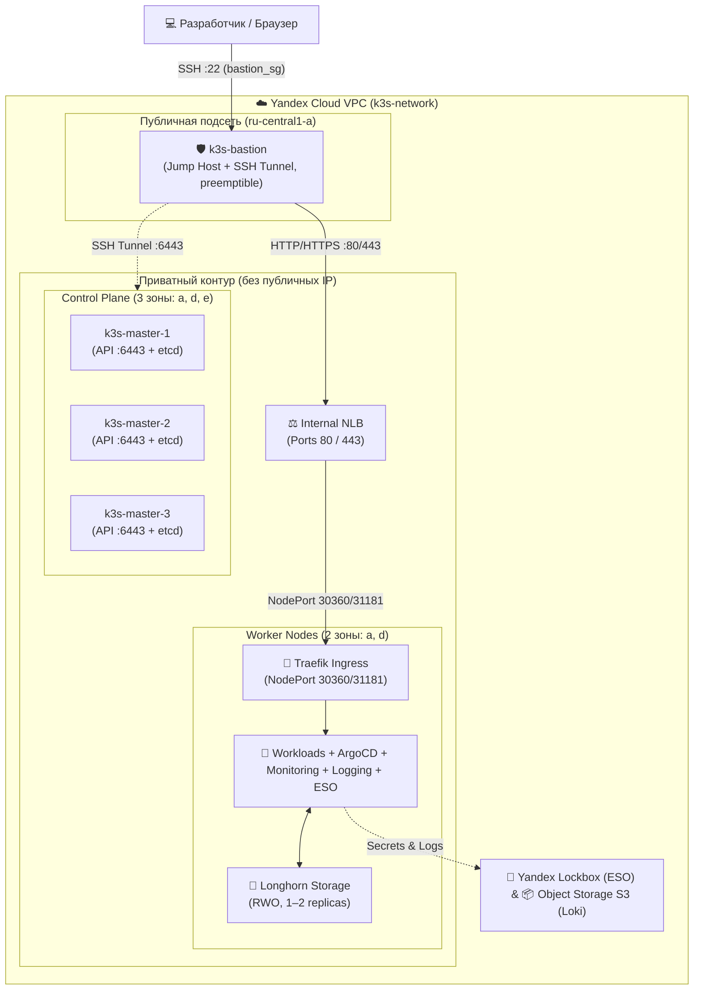

## ☸️ K3s: Деплой, GitOps, Мониторинг и Логирование ☸️

Проектирование, автоматизация развертывания (IaC OpenTofu/Ansible) и обеспечение высокой доступности распределенного кластера K3s в облачной инфраструктуре Yandex Cloud с интегрированным стеком мониторинга и логирования.

[](./CHANGELOG.md)
[](./LICENSE)
[](./docs/slo.md)
[](./docs/failure-modes.md)
[](./docs/production-gaps.md)
[](./docs/tech-debt.md)
[](./docs/audit-backlog.md)
[](./docs/multi-zonal-limitation.md)

---

## 🏗️ Архитектура облачного стенда K3s 🏗️

## 🗺️ Общая схема 🗺️


## Компоненты

### Инфраструктура (Terraform / OpenTofu)

- **VPC** `k3s-network-${env}` — изолированная сеть (отдельная для dev и prod)
- **Подсети:** (создаются динамически через `for_each` в зависимости от зон окружения)
  - `k3s-public-buckets (10.200.1.0/24 для зоны a, 10.201.1.0/24 для зоны d)` — публичный контур для бастиона.
  - `k3s-private-subnets (10.200.2.0/24 для зоны a, 10.202.2.0/24 для зоны d)` — для мастер-нод.
  - `k3s-workers-subnets (10.200.3.0/24 для зоны a, 10.202.3.0/24 для зоны d)` — для воркер-нод.
- **`NAT-шлюз`** — для выхода приватных нод в интернет.
- **Security Groups:**
 - `bastion_sg` (SSH только с admin_allowed_ips). (в tech-debt P1 описал решение для командной работы)
 - `cluster_sg` (межнодовое общение, K8s API, NodePort Traefik).
 - `nlb_sg` (трафик от внутреннего NLB к NodePort воркеров).

### Кластер (Ansible + K3s)

- **3 мастера** в 3 зонах (HA etcd-кворум).
- **2 воркера** в 2 зонах.
- **K3s** — легковесный Kubernetes.
- **ArgoCD** — GitOps-оператор.
- **Longhorn** — распределённое блочное хранилище (2 реплики).

### Доступ

- **SSH** — через бастион.
- **Kubernetes API** — через SSH-туннель (127.0.0.1:6443).
- **Публичного NLB нет** — сознательный компромисс (см. Trade-offs в README).

## Стоимость

- **~20-40 ₽ за 2 часа работы** (6 ВМ, прерываемые, 20% vCPU).
- **~0 ₽/мес**, когда стенд не поднят (все ВМ удалены).

---

## Рабочий процесс (Как ведется работа над проектом)

 - Регулярность: коммичу часто, не коплю изменения.
 - Ветки: `feature`-ветки под крупные задачи, `infra-tests`-для тестов, squash-мерж в master.
 - Документация: CHANGELOG README failure-modes SLO и trade-offs в `/docs`
 - Автоматизация: линтеры в CI (yamllint, Gitleaks, Trivy, kube-score), pre-commit hooks.
 - Ревью: self-review, приветствую внешний фидбек.

---

### ⚠️ Осознанные компромиссы и архитектурные ограничения (Trade-offs)

При проектировании этой архитектуры был сделан осознанный выбор в пользу встроенного консенсуса k3s (вместо классического выделенного кластера `etcd`), что накладывает определенные ограничения.

#### 1. **Отсутствие глубокого опыта с классическим `etcd`**:
В данной схеме мы не настраиваем `etcd` вручную «с нуля». Мы доверились абстракции k3s, которая берет это на себя под капотом. Для полноценного Production на «большом» Kubernetes ручная работа с `etcd` является обязательным навыком.

#### 2. **Производительность встроенного консенсуса (Embedded etcd)**:
K3s использует встроенный в бинарник движок `etcd` для организации распределенного консенсуса Raft между тремя мастер-нодами. На реальном высоконагруженном продакшене встроенный embedded-кластер может уступать по производительности выделенному кластеру `etcd`.

#### 3. **Связанность Control Plane и State**:
В нашей схеме компоненты управления кластером и база данных (State) живут внутри одних и тех же контейнеров. В Enterprise-архитектурах базу данных (`etcd`) принято выносить на абсолютно независимые серверы.

#### 4. **preemptible ноды**:
Мастера и воркеры — прерываемые (`preemptible`) VM.
**Что это даёт:** Стоимость стенда значительно дешевле.
**Что это ломает:** `HA` обеспечивается на уровне workload'ов, но **не на уровне инфраструктуры**. Реклейм VM облаком → Pod пересоздаётся на другой ноде. Для `stateful` (PG, Longhorn) — это **failover** (ожидаемое поведение, не баг).

#### 5. **Bastion-only доступ вместо публичного NLB**
- На старте проекта было принято решение не публиковать Kubernetes API (6443) в интернет. Вместо этого — доступ через `bastion-хост и SSH-туннель`.

**Причины:**
1. **Экономия:** публичный IP + NLB = ~250–300 ₽/мес на эфемерном стенде.
2. **Безопасность:** API-сервер не виден из интернета, SG ограничивает доступ только доверенными IP.

**Что это ломает:**  автоматизацию CI/CD с публичными раннерами. Для production потребуется один из вариантов:
- `Внешний NLB + публичные IP мастеров + SG по IP раннеров.`
- `Self-hosted ARC (Actions Runner Controller) внутри VPC — без публичных IP.`
- `VPN в VPC + internal NLB.`

#### 6. **Bastion-проблема SPOF**
Бастион — прерываемая ВМ. Риск остановки в момент деплоя минимален, но существует. В продакшне бастион должен быть **обязательно** на обычной ВМ!

#### 7. **Longhorn для HA-хранилища**
Для обеспечения отказоустойчивости данных был выбран **Longhorn** вместо **Rook-Ceph**.

**Причины:** Ceph требует минимум 3 ноды с 8+ ГБ RAM и выделенными NVMe-дисками. На нашем стенде Ceph будет нестабилен. Longhorn создан для небольших кластеров, не требует сырых дисков и ставится за 10 минут.

**Ограничения:**
- **Только `ReadWriteOnce` (RWO)**.
- **2 реплики вместо 3** — компромисс для слабых нод.
- в `/docs/tech-debt.md` **P0** описано решение для обхода ограничения.

---

## 🏗 Что внутри проекта (🌐 Архитектура облачного стенда)

* **Кластер**: K3s (Multi-Zonal HA-кластер).
  - **Prod**: 3 мастер-ноды (`ru-central1-a`, `ru-central1-d`, `ru-central1-e\f`) + 2 воркер-ноды (`a`, `d`).
  - **Dev**: 1 мастер-нода (`ru-central1-a`) + 1 воркер-нода (`a`). *Используется для быстрых проверок и экономии квот.*
* **Приложение**: Веб-сервер Nginx (с ограничением по CPU/RAM и постоянным диском на Longhorn).
* **GitOps**: ArgoCD (паттерн App of Apps).
* **Секреты**: Yandex Lockbox + External Secrets Operator (ESO). Секреты не хранятся в Git, ESO забирает их из облака и создает K8s Secrets на лету.
* **Мониторинг**: Prometheus + Grafana (установка через Helm).
* **Логирование**: Grafana Loki (Distributed, хранение чанков в S3 Yandex Object Storage) + Alloy.
* **Эфемерный стенд и S3**: Бакет Object Storage для Loki живет отдельно от стенда и **не удаляется** при `make down`.

### Сетевая архитектура

* **`k3s-bastion`** — Точка входа для SSH и управления кластером (публичный IP).
* **Мастер-ноды** — приватные, без публичного IP.
* **Воркер-ноды** — приватные, без публичного IP.
* **Доступ к API**: через SSH-туннель до мастера (через bastion).
* **NLB**: Внутренний балансировщик, который принимает трафик 80/443 и пробрасывает его на NodePort Traefik (`30360`/`31181`) на воркерах. Публичного IP у NLB нет.

**Полная Схема Доступна в файле `docs/architecture.md`**

**🔑 Ключевые особенности схемы:**

1. **Разделение точек входа (Безопасный периметр)**: Весь административный трафик (SSH и Kubernetes API) полностью изолирован от внешнего мира и доступен строго через выделенный бастион-хост (`k3s-bastion`). Веб-сервисы (80/443) доступны через внутренний NLB и Traefik (по NodePort).
2. **Гибридный сетевой контур**: Сеть разделена на пулы:
   - **Публичная подсеть** — для бастиона (единственная ВМ с публичным IP).
   - **Приватные подсети мастеров и воркеров** — создаются динамически в зависимости от окружения (dev/prod).
3. **Эфемерность нод при неизменной точке входа**: Все ВМ — прерываемые (`preemptible = true`). Доступ к кластеру осуществляется через бастион, IP которого **меняется** при пересоздании, но это не требует ручной перенастройки конфигов: перед работой ты запускаешь SSH-туннель одной командой (`make tunnel ENV=dev`).

## 📁 Структура проекта

```text
k3s-cloud-platform/
├── .github/
│   └── workflows/
│       └── ci.yaml                  # CI/CD (GitHub Actions)
├── .gitlab/
│   └── workflows/
│       └── ci.yaml                  # CI/CD (GitLab)
├── .gitverse/
│   └── workflows/
│       └── ci.yaml                  # CI/CD (GitVerse)
├── ansible/
│   ├── roles/
│   │   ├── k3s_kubeconfig/          # Копирование и локальный импорт kubeconfig
│   │   └── local_env/               # Настройка локального окружения разработчика
│   ├── eso-secret.yaml.j2           # Шаблон секрета yc-auth для ESO
│   └── site.yaml                    # Плейбук (K3s, ArgoCD, ESO Auth, Root App)
├── docs/
│   ├── multi-zonal-limitation       # ADR01: отказ от 3-зонного HA (квоты, кворум etcd) на момент 11.11.26 имеет место быть, зона f добавлена только сегодня.
│   ├── architecture.md              # Описание архитектуры стенда
│   ├── failure-modes.md             # Анализ отказов и сценариев деградации
│   ├── audit-backlog.md             # Конкретные технические недочеты (баги и мисконфиги), выявленные при аудите инфраструктуры.
│   ├── production-gaps.md           # Пять столпов Production (Стратегический аудит)
│   ├── slo.md                       # SLO/SLI для сервисов стенда
│   ├── tech-debt.md                 # Аудит: чек-лист задач
│   └── CHANGELOG.md                 # История изменений проекта
├── group_vars/
│   └── all/
│       ├── vars.yml                 # Переменные Ansible
│       └── vault.yml                # Секреты
├── k8s/
│   ├── apps/
│   │   └── nginx/                   # Helm-чарт приложения
│   ├── argocd/
│   │   └── root-app.yaml            # Корневой манифест App of Apps
│   └── platform/
│       ├── argocd-apps/
│       │   ├── external-secrets-app.yaml   # Application для ESO (sync-wave -2)
│       │   ├── logging-secrets-app.yaml    # Application для секретов Loki (sync-wave -1)
│       │   ├── monitoring-secrets-app.yaml # Application для секретов Grafana (sync-wave -1)
│       │   ├── loki-app.yaml               # Application для Loki (sync-wave 0)
│       │   ├── monitoring-app.yaml         # Application для kube-prometheus-stack
│       │   ├── longhorn-app.yaml           # Application для Longhorn
│       │   ├── nginx-app.yaml              # Application nginx
│       │   └── traefik-app.yaml            # Application Traefik
│       ├── monitoring/
│       │   ├── values.yaml          # Настройки kube-prometheus-stack
│       │   └── secrets/
│       │       ├── secretstore.yaml
│       │       └── externalsecret-grafana.yaml
│       └── logging/
│           ├── values-loki.yaml     # Настройки Loki (Distributed, S3)
│           ├── values-alloy.yaml    # Настройки Alloy
│           └── secrets/
│               ├── secretstore.yaml
│               └── externalsecret-loki.yaml
├── scripts/
│   └── tunnel.sh                    # Поднимает SSH-туннель
├── terraform/
│   ├── hosts.ini.tpl                # Шаблон для автогенерации инвентаря Ansible
│   ├── main.tf                      # VPC, подсети, Security Groups, ВМ, NLB
│   ├── storage.tf                   # S3, Lockbox, ESO, ключи
│   ├── outputs.tf                   # Вывод IP
│   ├── providers.tf                 # Настройка провайдера Яндекса
│   ├── variables.tf                 # Объявление переменных кластера
│   ├── dev.tfvars                   # Переменные для dev (1 мастер, 1 воркер)
│   └── prod.tfvars                  # Переменные для prod (3 мастера, 2 воркера)
├── tf-bootstrap/                    # Bootstrap: создание YDB для S3-бэкенда OpenTofu
│   └── main.tf
├── ansible.cfg                      # Конфигурация Ansible
├── Makefile                         # Скрипты автоматизации (make up, make down)
└── README.md                        # Документация проекта
```

## ⚙️ Как это устроено:
### Описание доступа к сервисам с управляющего хоста:

* **Доступ к Kubernetes API (через SSH-туннель):** API-сервер (6443) не опубликован в интернет. Доступ с хост-машины — через SSH-туннель до bastion.

* **Локальная отладка и диагностика:** Для доступа к веб-интерфейсам инфраструктуры используется `kubectl port-forward`.

* **Эфемерность и борьба с дрейфом:** Кластер разворачивается строго под рабочую сессию `(make up ENV=dev / make ansible-deploy ENV=dev)` и полностью уничтожается командой `make down ENV=dev`.


### Команды управления

1. **Поднятие инфраструктуры в облаке (OpenTofu):**

   ```bash
   make up ENV=dev или make up ENV=prod
   ```

2. **Конфигурация кластера (Ansible):**

   ```bash
   make ansible-deploy ENV=dev (prod)
   ```

---

### 2. Запуск приложения (`k8s/apps/nginx/`)

Приложение упаковано в **Helm-чарт**:

 - `Chart.yaml` — метаданные.
 - `values.yaml` — параметры.
 - `templates/pvc.yaml` — постоянный диск (longhorn).
 - `templates/deployment.yaml` — 1 реплика.
- `templates/ingress.yaml` — маршрутизация Traefik.


### 3. GitOps

Приложения и платформенные компоненты управляются через **ArgoCD** :
- `k8s/platform/argocd-apps/` — манифесты Application.
- `k8s/platform/traefik-config.yaml` — HelmChartConfig.

### 4. Мониторинг и Секреты

 - Стек kube-prometheus-stack ставится через ArgoCD.
  - Безопасность учётных данных: Все чувствительные данные (пароль Grafana, Telegram-токены, S3 ключи) хранятся в Yandex Lockbox и подтягиваются в кластер через External Secrets Operator (ESO). В Git хранятся только ID секретов.
 - Alert rules: `NodeDown, PodCrashLooping, HighCPU`.


### 5. 🛡️ Локальная безопасность и валидация (Pre-commit)

Настроена автоматическая проверка кода перед коммитом (.`pre-commit-config.yaml`), а также `gitleaks` в CI.

### 6. ⚙️ Автоматизация и CI/CD

Реализован пайплайн статического анализа (`/workflows/ci.yaml`).

### 🔄 Этапы пайплайна:
 - Linting & Syntax (yamllint). - ВАЛИДАЦИЯ YAML + COMMITLINT — проверка сообщений коммитов
 - Secret Scanning (Gitleaks). - поиск секретов
 - Security Scanner (Trivy). - сканирование
 - K8s Best Practices (Kube-score). - best practices для k8s-манифестов
 - Notifications (Telegram). - уведомления об успехе или завале пайплайна.

---


## 🎯 Что нужно доработать до уровня Production (Технический долг)

Подробный разбор архитектуры, рисков и планов развития стенда вынесен в директорию `docs/`:

* **[Production Gaps (`docs/production-gaps.md`)](./docs/production-gaps.md)** — стратегический аудит стенда по пяти столпам Production.
* **[Tech Debt (`docs/tech-debt.md`)](./docs/tech-debt.md)** — приоритизированный чек-лист технических доработок (P0–P3).
* **[Audit Backlog (`docs/audit-backlog.md`)](./docs/audit-backlog.md)** — список выявленных мисконфигов и багов инфраструктуры.
* **[Failure Modes (`docs/failure-modes.md`)](./docs/failure-modes.md)** — анализ сценариев отказа и деградации кластера.
* **[SLO / SLI (`docs/slo.md`)](./docs/slo.md)** — целевые показатели надёжности сервисов платформы.
* **[ADR-01 (`docs/multi-zonal-limitation.md`)](./docs/multi-zonal-limitation.md)** — архитектурное решение по зонам доступности и кворуму etcd.
